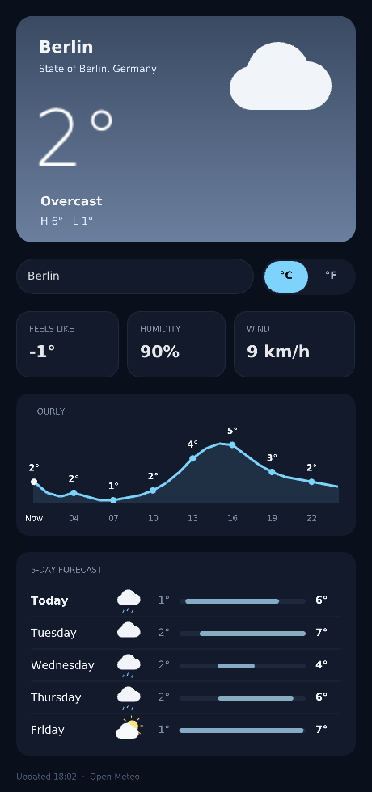

# Lui

Dear ImGui, written as markup. A `.lui` file is plain Lua plus XML-style tags:
every tag is one ImGui widget, attributes set its values, and `<on>` blocks
handle its events.

Lui keeps ImGui's speed and widget set, and adds a cleaner default theme,
retained state, data binding, and background HTTP requests.



```xml
<lui title="Counter" width=360 height=160>
local clicks = 0

<button>
    "Clicked {clicks} times"
    <on click>
        clicks = clicks + 1
    </on>
</button>

</lui>
```

## Requirements

Lui targets Linux with X11.

- A C compiler, `g++`, `make` and `pkg-config`
- Lua 5.3 (`pkg-config --libs lua5.3` must work)
- [raylib](https://www.raylib.com/), installed under `~/.local` (or set
  `RAYLIB_PREFIX` when running `make`)
- The DejaVu fonts (`/usr/share/fonts/truetype/dejavu/`)
- `curl`, for `L.get` background requests
- The git submodules: `git submodule update --init --recursive`

`make` expects a prebuilt `third_party/build/libcimgui_rl.a` (cimgui and
rlImGui). The repository does not yet include a script that builds it.

## Quick start

```bash
make                              # builds bin/luic and bin/lui_host
./lui run examples/widgets.lui    # compile and open the window
./lui watch examples/widgets.lui  # reopen the window on every save
```

`./lui build app.lui` compiles to `app.lui.lua` without opening a window.
Any `plugins/*.lua` next to the `.lui` file is loaded first.

Screenshots without a window: `LUI_SHOT=out.png LUI_SHOT_FRAMES=120` saves the
frame after that many frames and exits.

## Markup

- Everything outside a tag is Lua. `local name = <tag>…</tag>` binds an element
  to a Lua local, so handlers can change it (`name.text = "…"`).
- Elements are `<name> children </name>` or self-closing `<name />`. Names are
  case-sensitive.
- Attributes go inside the opening tag:
  - `key=12` or `key=1.5`: a number
  - `key="text"`: a string
  - `key={lua-expr}`: a Lua expression, re-evaluated every frame
  - `key`: a bare name means `true`
- A quoted string inside a tag is its text. `"Hi {name}"` interpolates Lua.
- `<on EVENT> … </on>` runs Lua when the event fires. The handler receives the
  element as `self`.
- `<!-- … -->` is a comment.

## Elements

| Tag | ImGui | Attributes | Events |
|---|---|---|---|
| `text` / `label` | Text | `wrap` | |
| `button` | Button | `width`, `height`, `bg` | `click` |
| `input` | InputText | `label`, `placeholder`, `width`, `height` (multi-line) | `change`, `submit` |
| `checkbox` | Checkbox | `label`, `checked` | `change` |
| `radio` | RadioButton | `label`, `checked` | `click` |
| `slider` | SliderFloat / SliderInt | `label`, `value`, `min`, `max`, `format`, `int` | `change` |
| `drag` | DragFloat | `label`, `value`, `speed`, `min`, `max`, `format` | `change` |
| `combo` | Combo | `label`, `items`, `selected` | `change` |
| `color` | ColorEdit3 | `label`, `value` | `change` |
| `progress` | ProgressBar | `value` (0–1), `text` overlay | |
| `plot` | PlotLines / PlotHistogram | `label`, `values`, `width`, `height`, `histogram` | |
| `selectable` | Selectable | `label`, `selected` | `click` |
| `separator` | Separator / SeparatorText | `text` | |
| `spacer` | Dummy | `width`, `height` | |
| `row` | SameLine between children | `gap` | |
| `column` / `group` | BeginGroup | | |
| `panel` | BeginChild, fits its content | `width`, `height`, `bg`, `border` | |
| `scroll` | BeginChild, scrolls | `height` (default 200), `bg`, `border` | |
| `window` | Begin | `title`, `width`, `height`, `x`, `y` | |
| `tabs` / `tab` | TabBar / TabItem | `label` (on `tab`) | |
| `tree` | TreeNode | `label`, `open` | |
| `collapse` | CollapsingHeader | `label`, `open` | |
| `menubar` / `menu` / `item` | MenuBar / Menu / MenuItem | `label` (`menu`, `item`), `shortcut`, `checked` | `click` (`item`) |
| `table` / `tr` / `td` | Table | `columns` (`"A,B"` or a count), `border` | |
| `canvas` | draw list | `width`, `height`, `bg`, `radius` | `draw`, `click` |

Every element also takes:

- `color`: text colour
- `size` and `weight` (0 regular, 1 bold, 2 light): font
- `tooltip`: text shown on hover
- `hover`, `leave`: fire when the pointer enters or leaves the element
- `frame`: runs every frame. Its second argument is the frame time in seconds.

Colours can be `"#rgb"`, `"#rrggbb"`, a name (`red`, `green`, `blue`, `gray`,
`yellow`, `orange`, `white`, `black`), or a number `0xRRGGBB`.

### Window

The `<lui>` tag configures the app: `title`, `width`, `height`,
`theme` (`dark` by default, or `light`), `accent`, `bg`, and `resizable`
(`true` by default). Top-level elements that are not `<window>`s fill the
screen. `<window>`s float on top.

## Drawing

A `<canvas>` `draw` handler gets `g`:

- `g.rect(x, y, w, h, radius, color, alpha)`
- `g.outline(x, y, w, h, radius, color, thickness)`
- `g.gradient(x, y, w, h, top, bottom)`
- `g.line(x1, y1, x2, y2, thickness, color)`
- `g.circle(x, y, r, color, alpha)`
- `g.text(s, x, y, size, color, weight)`
- `g.measure(s, size, weight)` returns the width of `s`
- `g.width`, `g.height`

Coordinates are relative to the canvas.

## Data and background requests

- `L.get(url, callback)` fetches a URL without blocking the window. It calls
  `callback(body)` on success or `callback(nil, message)` on failure.
- `L.json(text)` decodes JSON (`null` becomes `nil`). It returns `nil, message`
  on bad input.
- `L.urlencode(s)` escapes a query value.

## Custom elements

Plugins add elements with `L.define`. An element is drawn on its own canvas:

```lua
L.define("badge", {
    measure = function(n) return L.measure(n.text, 14, 1) + 18, 24 end,
    draw = function(n, g) g.rect(0, 0, g.width, g.height, g.height / 2, L.color(n.bg, 0x3b82f6)) end,
})
```

See `plugins/badge.lua` for a complete example.

## How it works

- `src/luic.c` compiles `.lui` into a Lua chunk that builds the element tree
  and registers the handlers. The output is minified.
- `src/lui.lua` runs in Lua 5.3 and walks the element tree every frame,
  calling ImGui through the `ig` table.
- `src/lui_imgui.cpp` binds the `ig` table to Dear ImGui and sets the theme.
- `src/lui_host.c` owns the raylib window, the frame loop, and background HTTP
  (curl on worker threads).

## Examples

- `examples/widgets.lui`: every element
- `examples/weather.lui`: background requests and a live layout (needs network)
- `examples/demo.lui`, `examples/counter.lui`, `examples/canvas.lui`,
  `examples/badges.lui`: smaller samples

## Tests

`tools/test_click.py` opens `examples/counter.lui.lua` in a window, clicks the
button through XTest, and checks the handler ran twice. It needs `xwininfo`,
`libX11` and `libXtst`.

```bash
./bin/luic examples/counter.lui
python3 tools/test_click.py examples/counter.lui.lua
```

## License

Not chosen yet.
